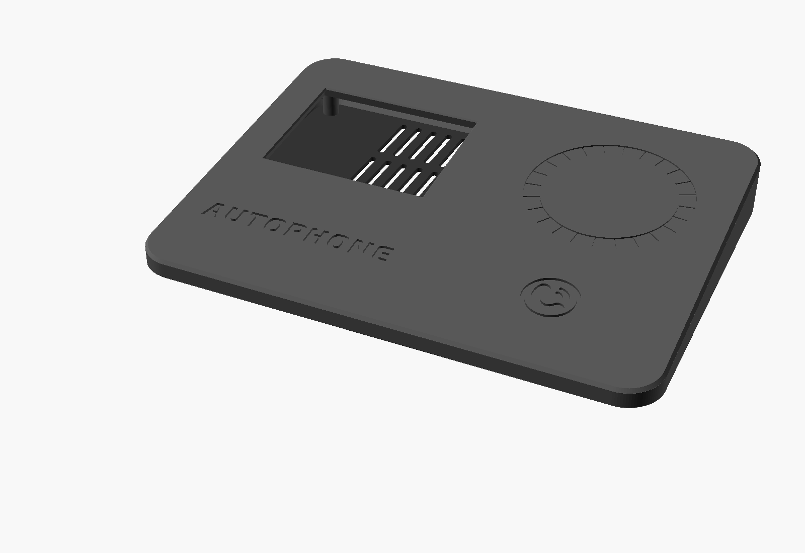

# autophone3D — the AutoPhone dock's 3D-printed case

The case of the [AutoPhone](https://autophoneagent.com) dock, as a parametric [OpenSCAD](https://openscad.org) model you can print on a home printer: a 2.8" touch screen on the left, a wireless charging pad with a MagSafe ring on the right, the top and the sides in one piece, and the only seam underneath.



> **Work in progress.** This is the case we print and use today. Coming next: a mount for a microphone (for meeting notes) and a revised layout for the charging board. Expect the parameters to move.

## What's here

| File | What it is |
|---|---|
| `autophone_dock.scad` | The model. Every size is a parameter at the top of the file; the comments keep the reason for each change (in Chinese). |
| `logo/logo_mark.scad` | The AutoPhone mark (ring, handset, sound waves). |
| `fonts/Exo2-W800.ttf` | Exo 2 ExtraBold, for the lettering (SIL Open Font License, `fonts/OFL-Exo2.txt`). |
| `stl/` | Ready-to-print parts, exported from the model as it is. |
| `images/` | Renders: the case, and the parts inside seen from below. |

### Printed parts (`stl/`)

| Part | File | Print |
|---|---|---|
| Case (top + sides) | `autophone_dock_shell.stl` | Top face down, already oriented |
| Bottom plate | `autophone_dock_plate2.stl` | Flat |
| Coil cover | `autophone_dock_cover.stl` | Flat side down; holds the charging coil and magnet in place |
| Screen clips ×14 | `autophone_dock_clipsbrim.stl` | With a one-layer brim that tears off |
| Logo + lettering | `autophone_dock_whites.stl` | Optional: a second colour (see below) |

## What it holds

Sizes as measured on our parts — change the parameters if yours differ.

- 2.8" ESP32 touch-screen board ("CYD", ESP32-2432S028R): glass 69 × 50 mm, held by four pins and printed clips, no screws
- ESP32 DevKit, 30 pins, headers removed (51.5 × 28 mm)
- A wireless charging coil (Ø 44 mm) with its magnet (Ø 49.5 mm) and a charging controller board (32 × 30 mm), under the coil cover
- A MagSafe-style magnetic sticker ring (55 / 45 mm, 0.5 mm thick) in the top's groove, so an iPhone snaps into place
- A USB-C breakout board (21.5 × 12 mm), the socket at the back, centred
- M2 × 6 countersunk self-tapping screws for the bottom plate

## Printing

Tested on Bambu Lab A1 and P1S printers (256 mm bed) with PLA.

- Case: 0.28 mm layers, bed 70 °C, **no skirt** (it sticks to the chamfer), first layer 30–40 mm/s. Let the bed cool below 35 °C before taking the case off: the long front edge stays straight.
- Use the printer's own start G-code (wipe and temperatures); a generic start code left the first layers weak.
- **Two colours with an AMS** (we use a P1S): print `whites` in white and the case in black as one multi-material print. The white logo and lettering are 0.84 mm deep by default (four layers). For a colourful mark, `logo3_w` / `logo3_o` / `logo3_g` split it into white, orange and green.
- **Two colours without an AMS:** export both parts with `-D mark_depth=0.32 -D logo_depth=0.32`, print `whites` first (two 0.16 mm layers, white), leave it on the bed, change to black and print the case on top **with bed levelling off** so the probe does not hit the white parts. Both files use the same coordinates; turn off auto-arrange in the slicer.
- Screen clips: print with their brim, then tear it off.

## Changing the model

Open `autophone_dock.scad` in OpenSCAD (2021 or newer; a recent build with the Manifold backend is much faster). The top of the file has the sizes; `part` picks what to show or export:

```
openscad -D 'part="shell"' -o shell.stl autophone_dock.scad
```

`part`: `shell`, `plate2`, `cover`, `clipsbrim`, `whites` to print; `assembly` (default), `inside`, `exploded` to look.

## License

Apache-2.0 (see `LICENSE`). The Exo 2 font is under the SIL Open Font License (`fonts/OFL-Exo2.txt`).

This repository is the case only. The dock's electronics and firmware are not part of it. Related open projects: [btbridge](https://github.com/tv149s/btbridge) (the Bluetooth voice bridge) and [chatnotes](https://github.com/tv149s/chatnotes) (the notes engine).

---

## 中文说明

AutoPhone 充电座的 3D 打印外壳，OpenSCAD 参数化模型，家用 3D 打印机就能打：左边是 2.8 寸触摸屏，右边是带 MagSafe 磁环的无线充电区；顶面和侧壁一体，唯一的接缝在底面。

**仍在迭代：** 这是我们现在打印、正在用的版本。下一步会加麦克风安装位（会议纪要用），并调整充电板的布局，参数还会变。

- **打印件**（`stl/`）：外壳（顶面朝下，已摆好方向）、底板、线圈压板、屏幕卡件 ×14（带可撕的一层裙边）、白色 logo 和文字（可选，双色）。
- **能装的器件**：2.8 寸 ESP32 触摸屏板（CYD）、30 针 ESP32 开发板（去掉排针）、无线充电线圈和磁片及充电控制板、MagSafe 磁吸贴环、USB-C 小板、底板用 M2×6 沉头自攻螺丝。尺寸都是参数，按你手上的零件改。
- **打印**（拓竹 A1 / P1S，PLA）：0.28 层高，热床 70 ℃，**不加裙边**，首层 30–40 mm/s，热床降到 35 ℃ 以下再取，前沿不容易变形；用打印机自己的开机 G-code。**有 AMS**（我们用 P1S）：白色打 `whites`、黑色打外壳，一次多色打印完成；白色 logo 和文字默认深 0.84 mm（4 层）；想要彩色 logo，可用 `logo3_w` / `logo3_o` / `logo3_g` 分成白、橙、绿三色。**没有 AMS**：导出时加 `-D mark_depth=0.32 -D logo_depth=0.32`，先用白色打 `whites`（两层 0.16），不取下，换黑色、**关掉热床调平**再打外壳；两个文件坐标一致，切片时关闭自动摆放。
- **修改**：用 OpenSCAD 打开 `autophone_dock.scad`，文件开头是尺寸参数，`part` 选择要显示或导出的零件。
- **许可证**：Apache-2.0；Exo 2 字体为 SIL OFL。本仓库只有外壳，不含底座的电路和固件。
